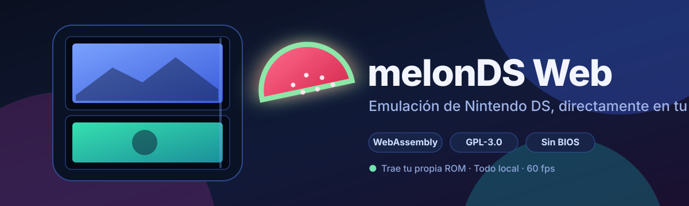
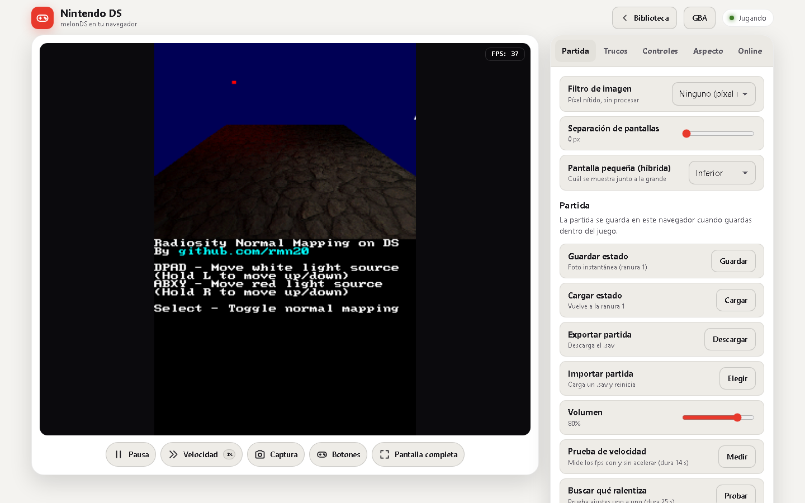
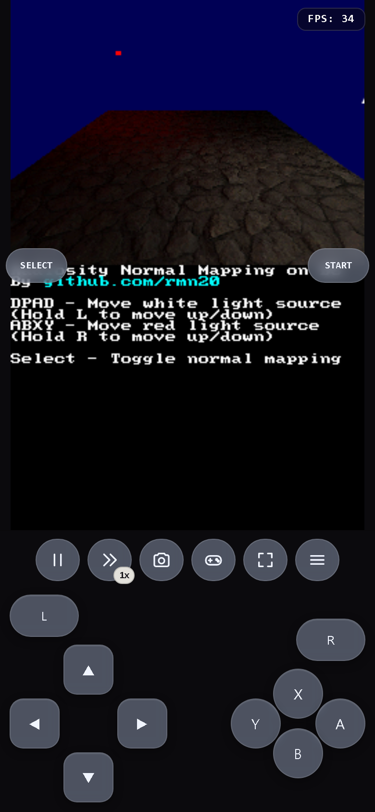
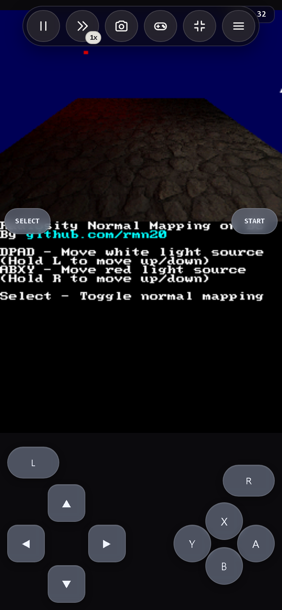
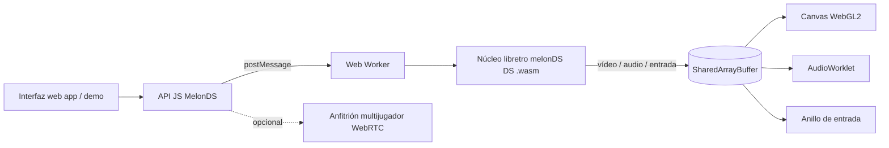

<p align="center">
  
</p>

<h1 align="center">melonDS Web</h1>

<p align="center">
  <b>English</b> · <a href="README.md">Read this README in English</a>
</p>

<p align="center">
  <b>Emulación precisa de Nintendo DS, completamente en tu navegador.</b><br>
  Con la potencia de <a href="https://github.com/JesseTG/melonDS-ds">melonDS DS v1.4.0</a> compilado a WebAssembly.
  Sin plugins, sin emulación en servidor y sin necesidad de BIOS: trae tu propia ROM.
</p>

<p align="center">
  <a href="LICENSE"></a>
  
  
  
  
  
</p>

<p align="center">
  <a href="#inicio-rápido">Inicio rápido</a> ·
  <a href="#características">Características</a> ·
  <a href="#usa-la-api">API</a> ·
  <a href="#compatibilidad">Compatibilidad</a> ·
  <a href="#documentación">Documentación</a> ·
  <a href="#legal">Legal</a>
</p>

---

## Míralo en acción

<p align="center">
  
</p>
<p align="center">
  
  
</p>

<p align="center">
  <sub>Capturas hechas con el homebrew <a href="https://github.com/rmn20/normalmappingds"><i>nmap</i></a>, de dominio público (CC0).
  En este repositorio no hay ninguna ROM, BIOS ni carátula comercial.</sub>
</p>

## ¿Por qué melonDS Web?

- **Emulación de verdad, en el navegador.** El núcleo libretro melonDS DS se ejecuta dentro de un Web Worker compilado a
  WebAssembly; los fotogramas viajan por `SharedArrayBuffer` y se presentan en un canvas WebGL2.
- **No hacen falta BIOS ni firmware.** Incluye FreeBIOS y genera un firmware en el navegador. Aun así puedes usar tus
  propios dumps a través de la API.
- **Trae tus propios juegos.** No se sube nada a ningún sitio: las ROM y las partidas se quedan en tu dispositivo (o en
  tu propio servidor, si despliegas la web app).
- **Sin cuentas, sin telemetría, sin subidas.** Todo corre en local.
- **Cómodo en el móvil.** Interfaz táctil adaptable, pantalla completa con controles, píldoras SELECT/START y un
  *service worker* de respaldo (`?coi=1`) para hostings estáticos sin cabeceras COOP/COEP.
- **Pensado para integrarse.** La API `MelonDS` es un módulo ES sin dependencias, y hay un adaptador compatible con
  EmulatorJS para la web app que lo acompaña.

## Características

| | |
|---|---|
| 🎮 **Núcleo DS preciso** | melonDS DS v1.4.0 (libretro), melonDS upstream `16f127db` |
| ⚡ **WebAssembly + hilos** | Emscripten 6.0.13, pthreads, SIMD, Web Worker; build de 2 GiB para cartuchos de 512 MB |
| 🖼️ **Vídeo** | canvas WebGL2, varias disposiciones de pantalla, escala entera o suave, filtros de imagen |
| 🔊 **Audio** | AudioWorklet, anillo compartido y control dinámico de velocidad a 1×; avance rápido con audio hasta 2× |
| 🎛️ **Entrada** | teclado, mando, ratón/toque en la pantalla inferior y controles táctiles (cruceta, A/B/X/Y, L/R, SELECT/START) |
| 💾 **Guardado y estados** | importar/exportar `.sav`, estados rápidos y trucos Action Replay |
| 🌐 **Multijugador** | anfitrión cooperativo por WebRTC: los invitados ven el juego y envían entradas, también táctiles |
| 📱 **UI móvil** | vertical y horizontal, pantalla completa con controles, *safe-area*, tema y disposición del pad personalizables |
| 🧩 **Integración** | módulos ES sin dependencias ni framework; adaptador `?engine=wasm` para web apps existentes |
| 🛡️ **Higiene** | `scripts/check-clean.mjs` falla si una ROM, BIOS, firmware, partida o credencial fuera a entrar en el repositorio |

## Inicio rápido

### Opción A — release ya compilado

Cada release incluye un ZIP estático (`melonds-wasm-<versión>.zip`), `SHA256SUMS` y `RELEASE_NOTES.md`.

1. Descarga el último ZIP desde **[Releases](https://github.com/soyangelromero/melonds-wasm/releases)**.
2. Verifícalo: `sha256sum -c SHA256SUMS`.
3. Sirve la carpeta con cualquier servidor estático. La página debe quedar aislada entre orígenes (ver
   [requisitos de hosting](#requisitos-de-hosting)).
4. Abre `/demo/index.html` y elige tu ROM.

### Opción B — compilar desde el código

Requisitos: **Docker** (la compilación corre dentro de `emscripten/emsdk:6.0.13`) y **Node.js 22+**.

```bash
# En Windows, evita que se conviertan los finales de línea o los parches no aplican
git clone -c core.autocrlf=false --recurse-submodules https://github.com/soyangelromero/melonds-wasm.git
cd melonds-wasm

./scripts/build.sh          # Linux / macOS / Git Bash
# .\scripts\build.ps1       # Windows PowerShell

npm run serve               # http://localhost:8080/demo/index.html
```

La compilación genera `dist/melonds.js` y `dist/melonds.wasm`. Elige un archivo `.nds` en la demo y juega. La primera
compilación tarda unos 10 minutos; los cambios en JavaScript no necesitan recompilar.

### Usa la API en tu proyecto

```js
import { MelonDS } from "./js/melonds.js";

const ds = await MelonDS.create({ canvas: document.querySelector("canvas") });
await ds.loadRom(romBytes, { save: savBytes });   // Uint8Array; la partida es opcional
ds.start();                                        // el audio se desbloquea con el primer gesto
ds.setLayout("Top/Bottom");
const save = await ds.getSaveNow();                // bytes del .sav
```

API completa: [`API_CONTRACT.md`](API_CONTRACT.md). Para una web app,
[`adapters/webapp-adapter.js`](adapters/webapp-adapter.js) expone el mismo motor con la forma de EmulatorJS
(`?engine=wasm`).

## Requisitos de hosting

`SharedArrayBuffer` necesita aislamiento entre orígenes. Tu servidor debe enviar estas cabeceras:

```
Cross-Origin-Opener-Policy: same-origin
Cross-Origin-Embedder-Policy: require-corp
```

Si tu hosting no permite cabeceras (GitHub Pages, `python -m http.server`, almacenamiento de objetos), publica
`coi-sw.js` en la raíz del sitio y abre la página con **`?coi=1`**: un service worker aísla la página tras una recarga.
Necesita HTTPS o `localhost` para el service worker y `SharedArrayBuffer`.

## Compatibilidad

| Área | Estado |
|---|---|
| **Navegadores** | Chromium ✅ · Firefox ✅ · WebKit (motor de Safari) ✅ para vídeo/entrada; el WebKit de Playwright no trae `AudioWorkletNode`; Safari real sin probar |
| **Biblioteca NDS** | 4/4 títulos de la biblioteca de pruebas arrancan y dibujan, incluido un cartucho de 512 MB (necesita la build de 2 GiB) |
| **Escritorio / móvil** | ✅ teclado, mando, táctil y disposiciones vertical/horizontal |
| **Hosting** | cualquier host estático con COOP/COEP; `coi-sw.js` + `?coi=1` como alternativa; HTTPS para `SharedArrayBuffer` |
| **Tipos de guardado** | Flash 512 KiB verificado; el resto lo detecta melonDS |
| **No incluido** | Wi-Fi emulado, modo DSi y micrófono (en el roadmap); nunca se distribuyen ROM ni BIOS comerciales |

## Arquitectura



```
core/        host C++ de libretro + core/patches aplicados a melonDS DS
js/          reproductor, audio, entrada, guardado, trucos, filtros, API MelonDS
adapters/    adaptador para web app y anfitrión multijugador WebRTC
demo/        demos independientes
scripts/     build con Docker, servidor estático, empaquetado, release e higiene
tests/       pruebas unitarias y de navegador, informes y benchmarks
docs/        documentación extra y capturas generadas
third_party/ submódulo melonDS DS v1.4.0
```

## Rendimiento

Medido en Chromium headless sobre un equipo de 8 vCPU con GPU por software:

- Títulos de 128 MB: **~55-60 fps de worker** a 1×.
- Título de 256 MB: **~48-58 fps**.
- Cartucho de 512 MB: **~40 fps** de worker y un heap de 2 GiB; necesita la build de 2 GiB.
- El avance rápido es real; por encima de 2× el audio se silencia por diseño (el reloj de audio no llega a 3×) y la
  interfaz lo indica.

Las CPUs móviles serán más lentas; usa el botón de velocidad y el banco de pruebas integrado (*Medir velocidad*) para
encontrar un ajuste cómodo. Los números son orientativos, no una garantía.

## Tests y calidad

```bash
npm test                          # unitarias: 138 pruebas, 135 pasan, 3 omitidas
node tests/library-browser.mjs    # biblioteca NDS en la web app real (necesita tus ROM)
node tests/phase11-browser.mjs    # adaptador web app, escritorio y móvil
node scripts/check-clean.mjs      # sin ROM/BIOS/firmware/partidas/credenciales en el repo
```

Las pruebas de navegador necesitan Playwright (`npx playwright install chromium`) y algunas una carpeta de ROMs. El
chequeo de release también cubre paquete estático, release de terceros, cross-browser y acceso remoto. La evidencia y
los límites conocidos están en [`tests/`](tests) (informes en español).

## Documentación

- [`API_CONTRACT.md`](API_CONTRACT.md) — API pública `MelonDS`, disposiciones, eventos y errores.
- [`adapters/INTEGRATION.md`](adapters/INTEGRATION.md) — superficie exacta del adaptador para una web app existente.
- [`THIRD_PARTY.md`](THIRD_PARTY.md) — versiones, commits y licencias de todo lo enlazado en el `.wasm`.
- [`tests/FINAL_REPORT.md`](tests/FINAL_REPORT.md) · [`tests/FINAL_ACCEPTANCE.md`](tests/FINAL_ACCEPTANCE.md) — checklist
  de aceptación y evidencia automática.
- [`tests/BENCH.md`](tests/BENCH.md) — campaña de rendimiento, perfilado y optimizaciones.
- [`tests/MANUAL.md`](tests/MANUAL.md) — pasos de aceptación manual (guardar → cerrar → continuar sin firmware, mando, trucos).
- [`docs/PHASE14_WEBGL2_DSI.md`](docs/PHASE14_WEBGL2_DSI.md) — viabilidad de un renderer WebGL2 nativo y del modo DSi.

## Roadmap

- [x] melonDS DS v1.4.0 compilado a WebAssembly con renderer por hilos
- [x] adaptador de web app (`?engine=wasm`), UI táctil, pantalla completa y tema/disposición personalizables
- [x] guardado, estados, trucos, multijugador y acceso remoto protegido con `ACCESS_KEY`
- [x] release con ZIP + SHA256SUMS + prueba de terceros
- [ ] opcional: micrófono, `retro_reset` rápido y build con `-O3`/LTO
- [ ] receta de despliegue estable (túnel con nombre / VPS) y demo pública

## Legal

**Proyecto no oficial.** Sin relación con Nintendo, Game Freak, Creatures Inc. ni The Pokémon Company.
**No incluye ninguna ROM, BIOS, firmware ni partida**; solo funciona con copias que poseas legalmente. No se sube nada:
tu ROM se queda en el navegador.

Este port se desarrolló **con ayuda de IA (Claude y DeepSeek)** bajo la dirección y las pruebas del autor. Es una
recompilación de melonDS de código abierto, no una descompilación. No ha pasado una auditoría humana independiente:
pruébalo con tus propios juegos.

## Créditos

- [melonDS](https://melonds.kuribo64.net/), de Arisotura y colaboradores — el emulador.
- [melonDS DS](https://github.com/JesseTG/melonDS-ds) — el núcleo libretro que usa este port.
- [libretro](https://www.libretro.com/) / `libretro-common` y [Emscripten](https://emscripten.org/).
- Todas las personas que probaron el port, la web app y los controles táctiles.

## Licencia

**GPL-3.0** — ver [`LICENSE`](LICENSE). Como melonDS y melonDS DS son GPL-3.0, quien distribuya el `.wasm` debe
publicar también el código fuente correspondiente. Procedencia: [`THIRD_PARTY.md`](THIRD_PARTY.md).

---

<p align="center">
  <b>Si este proyecto te resulta útil o divertido, dale una ⭐ al repositorio — ayuda a que más fans de Nintendo DS lo encuentren.</b>
</p>
