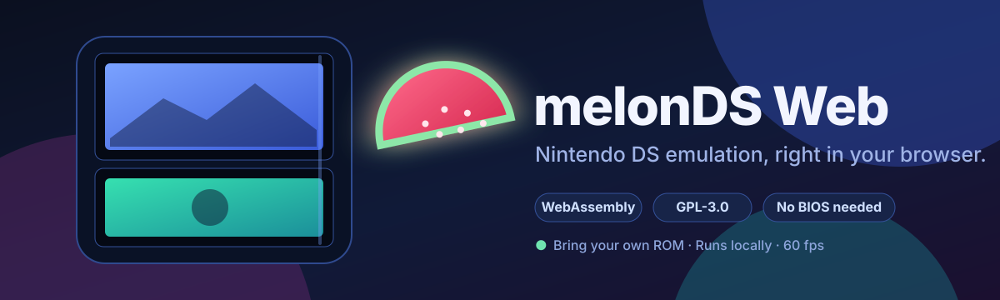
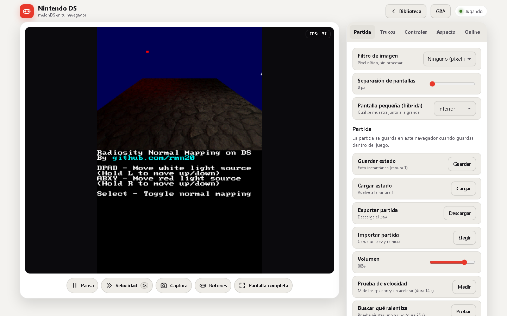
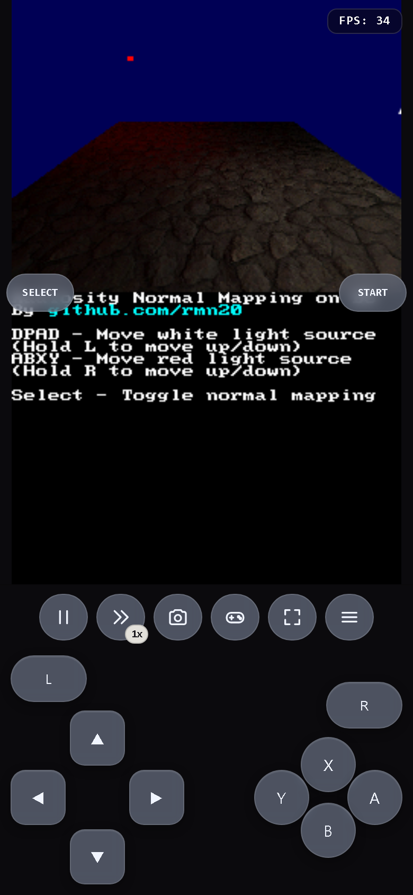
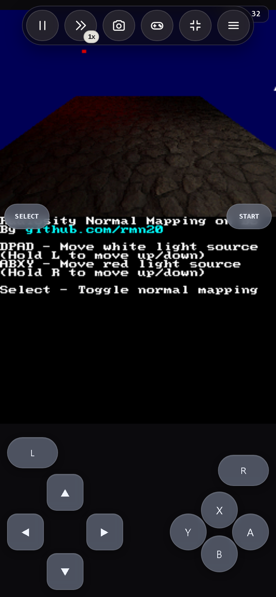
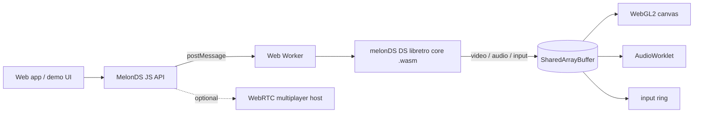

<p align="center">
  
</p>

<h1 align="center">melonDS Web</h1>

<p align="center">
  <b>Español</b> · <a href="README.es.md">Leer este README en español</a>
</p>

<p align="center">
  <b>Accurate Nintendo DS emulation, entirely in your browser.</b><br>
  Powered by <a href="https://github.com/JesseTG/melonDS-ds">melonDS DS v1.4.0</a> compiled to WebAssembly.
  No plugins, no server-side emulation, no BIOS files required — bring your own ROM.
</p>

<p align="center">
  <a href="LICENSE"></a>
  
  
  
  
  
</p>

<p align="center">
  <a href="#quick-start">Quick start</a> ·
  <a href="#features">Features</a> ·
  <a href="#use-the-api">API</a> ·
  <a href="#compatibility">Compatibility</a> ·
  <a href="#documentation">Docs</a> ·
  <a href="#legal">Legal</a>
</p>

---

## See it in action

<p align="center">
  
</p>
<p align="center">
  
  
</p>

<p align="center">
  <sub>Screenshots captured with the CC0 homebrew <a href="https://github.com/rmn20/normalmappingds"><i>nmap</i></a>.
  No commercial ROM, BIOS or box art is included in this repository.</sub>
</p>

## Why melonDS Web?

- **Real emulation, in the browser.** The melonDS DS libretro core runs inside a Web Worker compiled to WebAssembly; frames are shared through `SharedArrayBuffer` and presented on a WebGL2 canvas.
- **No BIOS or firmware files are required.** It ships with FreeBIOS and generates a firmware image in the browser. You can still plug in your own dumps through the API.
- **Bring your own games.** Nothing is uploaded anywhere: ROMs and saves stay on your device (or your own server).
- **No accounts, no telemetry, no uploads.** Everything runs locally in your browser; your ROM and saves never leave your device (unless you deploy the companion web app with your own server).
- **Comfortable on phones.** Responsive touch layout, fullscreen with controls, SELECT/START pills, and a `?coi=1` service-worker fallback for static hosts without COOP/COEP headers.
- **Built to be embedded.** A small, dependency-free `MelonDS` JavaScript API plus an EmulatorJS-compatible adapter for the companion web app.

## Features

| | |
|---|---|
| 🎮 **Accurate DS core** | melonDS DS v1.4.0 (libretro), upstream melonDS `16f127db` |
| ⚡ **WebAssembly + threads** | Emscripten 6.0.13, pthreads, SIMD, Web Worker; 2 GiB memory build for 512 MB cartridges |
| 🖼️ **Video** | WebGL2 canvas, multiple screen layouts, integer/scaled presentation, image filters |
| 🔊 **Audio** | AudioWorklet, ring buffer, dynamic rate control at 1×, fast-forward up to 2× with audio |
| 🎛️ **Input** | Keyboard, gamepad, mouse/touch on the lower screen, on-screen touch controls (D-pad, A/B/X/Y, L/R, SELECT/START) |
| 💾 **Saves & states** | Battery `.sav` import/export, quick save states, Action Replay cheats |
| 🌐 **Multiplayer** | WebRTC co-op host adapter: guests see the stream and send inputs, including touch |
| 📱 **Mobile UI** | Portrait/landscape, fullscreen including controls, safe-area support, customizable pad theme and layout |
| 🧩 **Integration** | Plain ES modules, no runtime dependencies, no framework; `?engine=wasm` adapter for existing web apps |
| 🛡️ **Hygiene** | `scripts/check-clean.mjs` fails if a ROM, BIOS, firmware, save or credential would enter the repository |

## Quick start

### Option A — prebuilt release

Every release includes a static ZIP (`melonds-wasm-<version>.zip`), `SHA256SUMS` and `RELEASE_NOTES.md`.

1. Download the latest ZIP from **[Releases](https://github.com/soyangelromero/melonds-wasm/releases)**.
2. Verify it: `sha256sum -c SHA256SUMS`.
3. Serve the folder with any static server. The page must be cross-origin isolated (see [hosting requirements](#hosting-requirements)).
4. Open `/demo/index.html` and choose your ROM.

### Option B — build from source

Requirements: **Docker** (the build runs inside `emscripten/emsdk:6.0.13`) and **Node.js 22+**.

```bash
# Keep line endings untouched on Windows, otherwise the patches do not apply
git clone -c core.autocrlf=false --recurse-submodules https://github.com/soyangelromero/melonds-wasm.git
cd melonds-wasm

./scripts/build.sh          # Linux / macOS / Git Bash
# .\scripts\build.ps1       # Windows PowerShell

npm run serve               # http://localhost:8080/demo/index.html
```

The build writes `dist/melonds.js` and `dist/melonds.wasm`. Pick a `.nds` file in the demo and play. First build is ~10 minutes; JavaScript changes need no rebuild.

### Use the API in your project

```js
import { MelonDS } from "./js/melonds.js";

const ds = await MelonDS.create({ canvas: document.querySelector("canvas") });
await ds.loadRom(romBytes, { save: savBytes });   // Uint8Array; save is optional
ds.start();                                        // audio unlocks on first user gesture
ds.setLayout("Top/Bottom");
const save = await ds.getSaveNow();                // .sav bytes
```

Full API: [`API_CONTRACT.md`](API_CONTRACT.md). In a web app, [`adapters/webapp-adapter.js`](adapters/webapp-adapter.js) exposes the same engine as an EmulatorJS-shaped object (`?engine=wasm`).

## Hosting requirements

`SharedArrayBuffer` needs cross-origin isolation. Send these headers from your server:

```
Cross-Origin-Opener-Policy: same-origin
Cross-Origin-Embedder-Policy: require-corp
```

If your host cannot set headers (GitHub Pages, `python -m http.server`, object storage), publish `coi-sw.js` at the site root and open the page with **`?coi=1`**: a service worker isolates the page after one reload. HTTPS or `localhost` is required for service workers and `SharedArrayBuffer`.

## Compatibility

| Area | Status |
|---|---|
| **Browsers** | Chromium ✅ · Firefox ✅ · WebKit (Safari engine) ✅ for video/input; the Playwright WebKit build lacks `AudioWorkletNode`; real Safari is untested |
| **NDS library** | 4/4 titles in the test library boot and render, including a 512 MB cartridge (needs the 2 GiB build) |
| **Desktop / mobile** | ✅ keyboard, gamepad, touch, portrait and landscape layouts |
| **Hosting** | Any static host with COOP/COEP; `coi-sw.js` + `?coi=1` fallback; HTTPS for `SharedArrayBuffer` |
| **Save types** | Flash 512 KiB verified; other types via melonDS' save detection |
| **Not included** | Wi-Fi emulation, DSi mode, microphone (roadmap); commercial ROMs/BIOS are never distributed |

## Architecture



```
core/        C++ libretro host + core/patches applied to melonDS DS
js/          player, audio, input, saves, cheats, filters, MelonDS API
adapters/    web-app adapter and WebRTC multiplayer host
demo/        standalone demo pages
scripts/     Docker build, static server, packaging, release, hygiene check
tests/       unit + browser tests, reports and benchmarks
docs/        extra documentation and generated screenshots
third_party/ melonDS DS v1.4.0 submodule
```

## Performance

Measured in headless Chromium on an 8-vCPU desktop with software GPU:

- 128 MB titles: **~55-60 worker fps** at 1×.
- 256 MB title: **~48-58 fps**.
- 512 MB cartridge: **~40 fps** worker, 2 GiB heap; needs the 2 GiB build.
- Fast-forward is real; above 2× audio is muted by design (the audio clock cannot feed 3×), and the UI indicates it.

Mobile CPUs will be slower; use the on-screen speed button and the built-in benchmark (`Medir velocidad`) to find a comfortable setting. Numbers are indicative, not a guarantee.

## Tests & quality

```bash
npm test                          # unit tests: 138 tests, 135 passing, 3 skipped
node tests/library-browser.mjs    # NDS library through the real web app (needs your ROMs)
node tests/phase11-browser.mjs    # web-app adapter, desktop + mobile layout
node scripts/check-clean.mjs      # no ROM/BIOS/firmware/saves/credentials in the repo
```

Browser tests require Playwright (`npx playwright install chromium`) and some of them a ROM folder. The CI-style release check also covers package, third-party release, cross-browser and remote-access smoke tests. Full evidence and known limits live in [`tests/`](tests) (reports in Spanish).

## Documentation

- [`API_CONTRACT.md`](API_CONTRACT.md) — public `MelonDS` API, layouts, events, errors.
- [`adapters/INTEGRATION.md`](adapters/INTEGRATION.md) — exact adapter surface for an existing web app.
- [`THIRD_PARTY.md`](THIRD_PARTY.md) — versions, commits and licenses of everything linked into the `.wasm`.
- [`tests/FINAL_REPORT.md`](tests/FINAL_REPORT.md) · [`tests/FINAL_ACCEPTANCE.md`](tests/FINAL_ACCEPTANCE.md) — acceptance checklist and automatic evidence.
- [`tests/BENCH.md`](tests/BENCH.md) — performance campaign, profiling and optimizations.
- [`tests/MANUAL.md`](tests/MANUAL.md) — manual acceptance steps (save → close → continue without firmware, gamepad, cheats).
- [`docs/PHASE14_WEBGL2_DSI.md`](docs/PHASE14_WEBGL2_DSI.md) — feasibility of a native WebGL2 renderer and DSi mode.

## Roadmap

- [x] melonDS DS v1.4.0 compiled to WebAssembly, threaded renderer
- [x] Web app adapter (`?engine=wasm`), mobile touch UI, fullscreen, customizable theme/layout
- [x] Saves, states, cheats, multiplayer host, remote-access guard (`ACCESS_KEY`)
- [x] Release bundle with ZIP + SHA256SUMS + third-party verification
- [ ] Optional: microphone interface, `retro_reset` fast reset, `-O3`/LTO build
- [ ] Stable deployment recipe (named tunnel / VPS) and a public demo

## Legal

**Unofficial hobby project.** Not affiliated with Nintendo.
It **does not include any ROM, BIOS, firmware or save file**; it only works with copies you legally own. Nothing is uploaded:
your ROM stays in the browser.

This port was developed **with AI assistance (Claude and DeepSeek)** under the author's direction and testing. It is a
recompilation of open-source melonDS, not a decompilation. It has not had an independent human audit — test it with your
own games.

## Credits

- [melonDS](https://melonds.kuribo64.net/) by Arisotura and contributors — the emulator.
- [melonDS DS](https://github.com/JesseTG/melonDS-ds) — the libretro core used here.
- [libretro](https://www.libretro.com/) / `libretro-common`, [Emscripten](https://emscripten.org/).
- Everyone who tested the port, the web app and the touch layouts.

## License

**GPL-3.0** — see [`LICENSE`](LICENSE). Because melonDS and melonDS DS are GPL-3.0, anyone distributing the `.wasm` must
make the corresponding source available. Provenance: [`THIRD_PARTY.md`](THIRD_PARTY.md).

---

<p align="center">
  <b>If this project is useful or fun, please ⭐ star the repository — it helps other Nintendo DS fans find it.</b>
</p>
